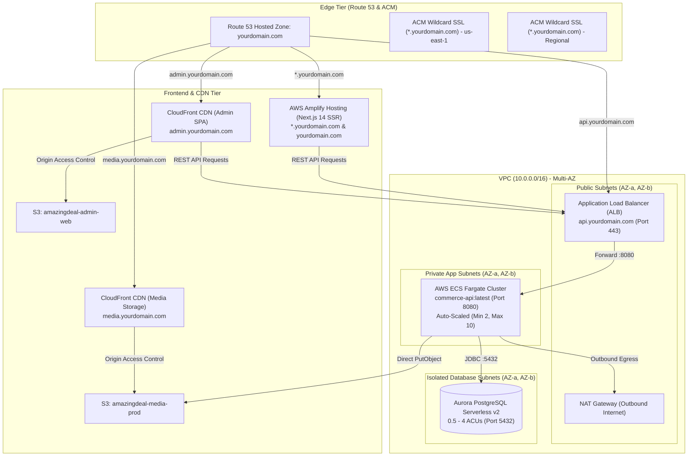

# AWS Enterprise Production Deployment Guide 🚀
## Strategy C: Enterprise AWS Stack for AmazingDeal Multi-Tenant Platform

This guide provides an end-to-end, production-grade deployment walkthrough for **Strategy C** of the **AmazingDeal Multi-Tenant Commerce Platform**:

* **Database**: AWS Aurora PostgreSQL Serverless v2 (Multi-AZ)
* **Backend API**: AWS ECS Fargate (Containerized Spring Boot 3 + Java 21)
* **Storefront Web**: AWS Amplify Hosting (Next.js 14 App Router SSR + Wildcard Subdomains)
* **Admin Web**: Amazon S3 + CloudFront (Static React/Vite SPA)
* **Media Storage**: Amazon S3 + CloudFront CDN (Global Edge Caching)
* **Networking & DNS**: AWS Route 53 + ACM (Wildcard SSL `*.yourdomain.com`)

---

## 🏗️ 1. Architecture Blueprint & Traffic Flow



---

## 📋 2. Prerequisites & CLI Configuration

Ensure you have:
1. **AWS Account** with administrative permissions.
2. **AWS CLI v2** installed and configured (`aws configure`).
3. **Docker** installed and running locally.
4. **Git** connected to your repository (GitHub, AWS CodeCommit, or GitLab).
5. A registered custom domain (e.g., `amazingdeal.store` or `yourdomain.com`) configured in **Amazon Route 53** as a Public Hosted Zone.

Set common environment variables for this deployment:
```bash
export AWS_REGION="us-east-1"
export AWS_ACCOUNT_ID=$(aws sts get-caller-identity --query Account --output text)
export DOMAIN_NAME="yourdomain.com"
export DB_NAME="amazingdeal_commerce"
```

---

## 🌐 3. Phase 1: Networking & Foundation (VPC & Security Groups)

### 3.1. Create Multi-AZ VPC
Create a VPC with:
* **2 Public Subnets** (for ALB & NAT Gateway)
* **2 Private Application Subnets** (for ECS Fargate tasks)
* **2 Isolated Database Subnets** (for Aurora Serverless v2)

### 3.2. Define Least-Privilege Security Groups
Create three security groups to enforce network isolation:

```bash
# 1. ALB Security Group (Internet-facing)
aws ec2 create-security-group \
  --group-name alb-sg \
  --description "Security group for Commerce API ALB" \
  --vpc-id <VPC_ID>

# Allow inbound HTTP/HTTPS from anywhere
aws ec2 authorize-security-group-ingress --group-id <ALB_SG_ID> --protocol tcp --port 80 --cidr 0.0.0.0/0
aws ec2 authorize-security-group-ingress --group-id <ALB_SG_ID> --protocol tcp --port 443 --cidr 0.0.0.0/0

# 2. ECS Fargate Service Security Group
aws ec2 create-security-group \
  --group-name ecs-commerce-api-sg \
  --description "Security group for ECS Commerce API tasks" \
  --vpc-id <VPC_ID>

# Allow inbound 8080 ONLY from ALB Security Group
aws ec2 authorize-security-group-ingress --group-id <ECS_SG_ID> --protocol tcp --port 8080 --source-group <ALB_SG_ID>

# 3. Aurora PostgreSQL Security Group
aws ec2 create-security-group \
  --group-name aurora-postgres-sg \
  --description "Security group for Aurora PostgreSQL" \
  --vpc-id <VPC_ID>

# Allow inbound 5432 ONLY from ECS Security Group
aws ec2 authorize-security-group-ingress --group-id <AURORA_SG_ID> --protocol tcp --port 5432 --source-group <ECS_SG_ID>
```

---

## 🗄️ 4. Phase 2: AWS Aurora PostgreSQL Serverless v2

Aurora Serverless v2 scales dynamically between 0.5 and 128 ACUs (Aurora Capacity Units) in fraction-of-a-second increments, making it ideal for multi-tenant e-commerce with fluctuating traffic.

### 4.1. Create DB Subnet Group
```bash
aws rds create-db-subnet-group \
  --db-subnet-group-name amazingdeal-db-subnet-group \
  --db-subnet-group-description "Subnets for Aurora PostgreSQL" \
  --subnet-ids "<DB_SUBNET_1_ID>" "<DB_SUBNET_2_ID>"
```

### 4.2. Store Database Master Credentials in AWS Secrets Manager
```bash
aws secretsmanager create-secret \
  --name "amazingdeal/production/database" \
  --description "Aurora PostgreSQL credentials for AmazingDeal" \
  --secret-string '{"username":"postgres","password":"YourSuperSecurePassword123!"}'
```

### 4.3. Provision Aurora Cluster & Instance
```bash
# 1. Create Aurora Cluster
aws rds create-db-cluster \
  --db-cluster-identifier amazingdeal-aurora-cluster \
  --engine aurora-postgresql \
  --engine-version 16.1 \
  --database-name amazingdeal_commerce \
  --master-username postgres \
  --master-user-password "YourSuperSecurePassword123!" \
  --db-subnet-group-name amazingdeal-db-subnet-group \
  --vpc-security-group-ids "<AURORA_SG_ID>" \
  --serverless-v2-scaling-configuration MinCapacity=0.5,MaxCapacity=4.0 \
  --storage-encrypted \
  --backup-retention-period 7

# 2. Add Primary Instance to the Cluster
aws rds create-db-instance \
  --db-instance-identifier amazingdeal-aurora-instance-1 \
  --db-cluster-identifier amazingdeal-aurora-cluster \
  --db-instance-class db.serverless \
  --engine aurora-postgresql
```

> [!NOTE]
> Aurora endpoint will be available once created:
> `<CLUSTER_IDENTIFIER>.cluster-<REGION>.rds.amazonaws.com`
> Flyway will execute migrations (`V1`, `V2`, `V3`) automatically upon initial ECS container startup.

---

## 📦 5. Phase 3: Media Storage Tier (Amazon S3 + CloudFront CDN)

Decoupling file uploads from container disk is mandatory for container auto-scaling.

### 5.1. Create Private Media S3 Bucket
```bash
aws s3api create-bucket \
  --bucket "amazingdeal-media-prod-${AWS_ACCOUNT_ID}" \
  --region ${AWS_REGION}

# Enable Server-Side Encryption (AES256)
aws s3api put-bucket-encryption \
  --bucket "amazingdeal-media-prod-${AWS_ACCOUNT_ID}" \
  --server-side-encryption-configuration '{"Rules":[{"ApplyServerSideEncryptionByDefault":{"SSEAlgorithm":"AES256"}}]}'

# Block Public Access (All traffic must pass through CloudFront CDN)
aws s3api put-public-access-block \
  --bucket "amazingdeal-media-prod-${AWS_ACCOUNT_ID}" \
  --public-access-block-configuration "BlockPublicAcls=true,IgnorePublicAcls=true,BlockPublicPolicy=true,RestrictPublicBuckets=true"
```

### 5.2. Create CloudFront Origin Access Control (OAC) & Distribution
1. Create an OAC for the S3 bucket in CloudFront.
2. Create CloudFront distribution with:
   * **Origin**: `amazingdeal-media-prod-${AWS_ACCOUNT_ID}.s3.amazonaws.com`
   * **Origin Access**: Origin Access Control (OAC)
   * **Viewer Protocol Policy**: Redirect HTTP to HTTPS
   * **Alternate Domain Name (CNAME)**: `media.yourdomain.com`
   * **Custom SSL Certificate**: ACM certificate for `*.yourdomain.com` (must be requested in `us-east-1`).
3. Apply the generated CloudFront OAC policy to the S3 bucket:

```json
{
  "Version": "2012-10-17",
  "Statement": {
    "Sid": "AllowCloudFrontServicePrincipalReadOnly",
    "Effect": "Allow",
    "Principal": {
      "Service": "cloudfront.amazonaws.com"
    },
    "Action": "s3:GetObject",
    "Resource": "arn:aws:s3:::amazingdeal-media-prod-${AWS_ACCOUNT_ID}/*",
    "Condition": {
      "StringEquals": {
        "AWS:SourceArn": "arn:aws:cloudfront::${AWS_ACCOUNT_ID}:distribution/<CLOUDFRONT_DISTRIBUTION_ID>"
      }
    }
  }
}
```

---

## 🐳 6. Phase 4: Backend API on AWS ECS Fargate

### 6.1. Create Amazon ECR Repository & Build/Push Image
```bash
# 1. Create ECR repository
aws ecr create-repository \
  --repository-name amazingdeal/commerce-api \
  --image-scanning-configuration scanOnPush=true

# 2. Authenticate Docker with ECR
aws ecr get-login-password --region ${AWS_REGION} | docker login --username AWS --password-stdin ${AWS_ACCOUNT_ID}.dkr.ecr.${AWS_REGION}.amazonaws.com

# 3. Build container using production Dockerfile
docker build -t ${AWS_ACCOUNT_ID}.dkr.ecr.${AWS_REGION}.amazonaws.com/amazingdeal/commerce-api:latest \
  -f services/commerce-api/Dockerfile ./services/commerce-api

# 4. Push image
docker push ${AWS_ACCOUNT_ID}.dkr.ecr.${AWS_REGION}.amazonaws.com/amazingdeal/commerce-api:latest
```

### 6.2. IAM Roles for ECS Fargate
Create two IAM roles:
1. **`ecsTaskExecutionRole`**: Allows ECS agent to pull images from ECR and write CloudWatch logs. Attach `AmazonECSTaskExecutionRolePolicy`.
2. **`ecsCommerceApiTaskRole`**: Granted to the container application runtime to interact with S3 media bucket:
   ```json
   {
     "Version": "2012-10-17",
     "Statement": [
       {
         "Effect": "Allow",
         "Action": ["s3:PutObject", "s3:GetObject", "s3:DeleteObject"],
         "Resource": "arn:aws:s3:::amazingdeal-media-prod-${AWS_ACCOUNT_ID}/*"
       }
     ]
   }
   ```

### 6.3. Application Load Balancer (ALB) Setup
1. **Create Target Group**:
   * Target Type: `IP` (Fargate requirement)
   * Protocol / Port: `HTTP` / `8080`
   * Health Check Path: `/actuator/health`
   * Healthy threshold: 2, Unhealthy threshold: 3, Timeout: 5s, Interval: 15s
2. **Create ALB**:
   * Scheme: Internet-facing
   * Subnets: Select 2 Public Subnets
   * Security Group: `<ALB_SG_ID>`
3. **Configure Listeners**:
   * Port 80: HTTP Redirect to Port 443 (HTTPS)
   * Port 443: HTTPS Listener with ACM certificate `*.yourdomain.com` forwarding to Target Group.

### 6.4. ECS Task Definition (`task-def.json`)
```json
{
  "family": "amazingdeal-commerce-api",
  "networkMode": "awsvpc",
  "requiresCompatibilities": ["FARGATE"],
  "cpu": "1024",
  "memory": "2048",
  "executionRoleArn": "arn:aws:iam::<ACCOUNT_ID>:role/ecsTaskExecutionRole",
  "taskRoleArn": "arn:aws:iam::<ACCOUNT_ID>:role/ecsCommerceApiTaskRole",
  "containerDefinitions": [
    {
      "name": "commerce-api",
      "image": "<ACCOUNT_ID>.dkr.ecr.<REGION>.amazonaws.com/amazingdeal/commerce-api:latest",
      "portMappings": [
        {
          "containerPort": 8080,
          "protocol": "tcp"
        }
      ],
      "essential": true,
      "environment": [
        { "name": "SPRING_PROFILES_ACTIVE", "value": "prod" },
        { "name": "SPRING_DATASOURCE_URL", "value": "jdbc:postgresql://amazingdeal-aurora-cluster.cluster-xyz.<REGION>.rds.amazonaws.com:5432/amazingdeal_commerce?sslmode=require" },
        { "name": "SPRING_DATASOURCE_USERNAME", "value": "postgres" },
        { "name": "APP_MEDIA_BASE_URL", "value": "https://media.yourdomain.com" },
        { "name": "APP_CORS_ALLOWED_ORIGINS", "value": "https://yourdomain.com,https://*.yourdomain.com,https://admin.yourdomain.com" }
      ],
      "secrets": [
        {
          "name": "SPRING_DATASOURCE_PASSWORD",
          "valueFrom": "arn:aws:secretsmanager:<REGION>:<ACCOUNT_ID>:secret:amazingdeal/production/database:password::"
        },
        {
          "name": "APP_JWT_SECRET",
          "valueFrom": "arn:aws:secretsmanager:<REGION>:<ACCOUNT_ID>:secret:amazingdeal/production/jwt:secret::"
        }
      ],
      "logConfiguration": {
        "logDriver": "awslogs",
        "options": {
          "awslogs-group": "/ecs/amazingdeal-commerce-api",
          "awslogs-region": "<REGION>",
          "awslogs-stream-prefix": "ecs"
        }
      }
    }
  ]
}
```

Register and create service:
```bash
aws ecs register-task-definition --cli-input-json file://task-def.json

aws ecs create-service \
  --cluster amazingdeal-cluster \
  --service-name commerce-api-service \
  --task-definition amazingdeal-commerce-api \
  --desired-count 2 \
  --launch-type FARGATE \
  --network-configuration "awsvpcConfiguration={subnets=[<APP_SUBNET_1>,<APP_SUBNET_2>],securityGroups=[<ECS_SG_ID>],assignPublicIp=DISABLED}" \
  --load-balancers "targetGroupArn=<TARGET_GROUP_ARN>,containerName=commerce-api,containerPort=8080"
```

---

## ⚡ 7. Phase 5: Storefront Web on AWS Amplify Hosting (Next.js 14 SSR)

AWS Amplify Hosting natively runs Next.js 14 SSR apps with zero EC2 maintenance.

### 7.1. Amplify Monorepo Build Specification (`amplify.yml`)
Place this configuration in AWS Amplify Console under **App Settings > Build Settings**:

```yaml
version: 1
applications:
  - appRoot: apps/storefront-web
    frontend:
      phases:
        preBuild:
          commands:
            - corepack enable
            - corepack prepare pnpm@latest --activate
            - pnpm install --frozen-lockfile
        build:
          commands:
            - pnpm run build
      artifacts:
        baseDirectory: .next
        files:
          - '**/*'
      cache:
        paths:
          - .next/cache/**/*
          - node_modules/**/*
          - $(pnpm store path)/**/*
```

### 7.2. Environment Variables in Amplify Console
Set the following environment variables:
* `NEXT_PUBLIC_API_URL`: `https://api.yourdomain.com/api/v1`
* `AMPLIFY_MONOREPO_APP_ROOT`: `apps/storefront-web`

### 7.3. Configure Wildcard Subdomains in AWS Amplify
1. Navigate to **Domain Management** in AWS Amplify Console.
2. Add your custom domain: `yourdomain.com`.
3. Configure subdomains:
   * Root: `yourdomain.com` -> branch `main`
   * Wildcard: `*.yourdomain.com` -> branch `main`
4. Amplify automatically validates ACM certificates and creates Route 53 alias records!
5. When a buyer visits `footwear.yourdomain.com` or `threads.yourdomain.com`, `apps/storefront-web/src/middleware.ts` extracts the subdomain and renders the tenant store seamlessly.

---

## 🖥️ 8. Phase 6: Merchant Admin Console on Amazon S3 + CloudFront

The Admin console (`apps/admin-web`) is a fast client-side Vite SPA. Hosting it on S3 + CloudFront offers lightning speed, 99.99% SLA, and near-zero cost.

### 8.1. Create Admin S3 Bucket & CloudFront Distribution
```bash
# 1. Create S3 Bucket
aws s3api create-bucket \
  --bucket "amazingdeal-admin-web-${AWS_ACCOUNT_ID}" \
  --region ${AWS_REGION}

# 2. Block public access
aws s3api put-public-access-block \
  --bucket "amazingdeal-admin-web-${AWS_ACCOUNT_ID}" \
  --public-access-block-configuration "BlockPublicAcls=true,IgnorePublicAcls=true,BlockPublicPolicy=true,RestrictPublicBuckets=true"
```

### 8.2. CloudFront SPA Error Handling (CRITICAL for React Router)
In the CloudFront distribution for `admin.yourdomain.com`:
* Configure **Custom Error Responses**:
  * HTTP Error Code: `403: Forbidden` -> Response Page Path: `/index.html`, HTTP Response Code: `200: OK`
  * HTTP Error Code: `404: Not Found` -> Response Page Path: `/index.html`, HTTP Response Code: `200: OK`

### 8.3. Build & Deploy Admin Assets
```bash
# Build admin web with production API endpoint
export VITE_API_BASE_URL="https://api.yourdomain.com/api/v1"
pnpm --filter admin-web build

# Sync built assets to S3
aws s3 sync apps/admin-web/dist s3://amazingdeal-admin-web-${AWS_ACCOUNT_ID} --delete

# Invalidate CloudFront cache
aws cloudfront create-invalidation \
  --distribution-id <ADMIN_CLOUDFRONT_DIST_ID> \
  --paths "/*"
```

---

## 🎯 9. Phase 7: Route 53 DNS & SSL Mapping Matrix

Configure your Route 53 Public Hosted Zone records:

| Record Name | Type | Target / Value | Purpose |
| :--- | :--- | :--- | :--- |
| `api.yourdomain.com` | **A (Alias)** | Dualstack DNS name of your ALB | REST API Backend Gateway |
| `admin.yourdomain.com` | **A (Alias)** | CloudFront Distribution for Admin Web | Merchant Console SPA |
| `media.yourdomain.com` | **A (Alias)** | CloudFront Distribution for Media S3 | Global CDN Media Storage |
| `yourdomain.com` | **A (Alias)** | AWS Amplify App Distribution | Root Marketplace Storefront |
| `*.yourdomain.com` | **CNAME / Alias**| AWS Amplify App Distribution | Wildcard Tenant Stores (`footwear.*`, `threads.*`) |

---

## 🧪 10. Phase 8: Verification & Smoke Testing Checklist

Run these terminal checks once DNS propagation finishes:

```bash
# 1. Verify Backend Health
curl -s -i https://api.yourdomain.com/actuator/health
# Expected: HTTP/1.1 200 OK -> {"status":"UP"}

# 2. Verify Swagger Docs
curl -s -i https://api.yourdomain.com/swagger-ui/index.html | head -n 10
# Expected: HTTP/1.1 200 OK

# 3. Verify Admin Console SPA
curl -s -I https://admin.yourdomain.com
# Expected: HTTP/2 200 OK (Served from CloudFront)

# 4. Verify Storefront Multi-Tenant Subdomain
curl -s -I https://footwear.yourdomain.com
# Expected: HTTP/2 200 OK with x-tenant-slug: footwear header

# 5. Verify Media CDN Caching
curl -s -I https://media.yourdomain.com/logo.png
# Expected: x-cache: Hit from cloudfront (or Miss on first fetch)
```

---

## 🛡️ 11. Cost Optimization & Auto-Scaling Summary

| Resource | Development / Low Load | Peak Enterprise Traffic | Auto-Scaling Mechanism |
| :--- | :--- | :--- | :--- |
| **Aurora PostgreSQL** | 0.5 ACU (~$43/mo) | Up to 4 - 16 ACUs | Automatic Aurora Serverless scaling |
| **ECS Fargate Tasks** | 2 tasks (0.5 vCPU, 1GB RAM) | 10+ tasks | Target Tracking (CPU > 70% or Request Count) |
| **AWS Amplify SSR** | Pay per build min + SSR request | Scales automatically | Edge Lambda / Serverless SSR workers |
| **CloudFront & S3** | Free tier / Pay per GB egress | Global 450+ Edge Locations | 100% Serverless |
