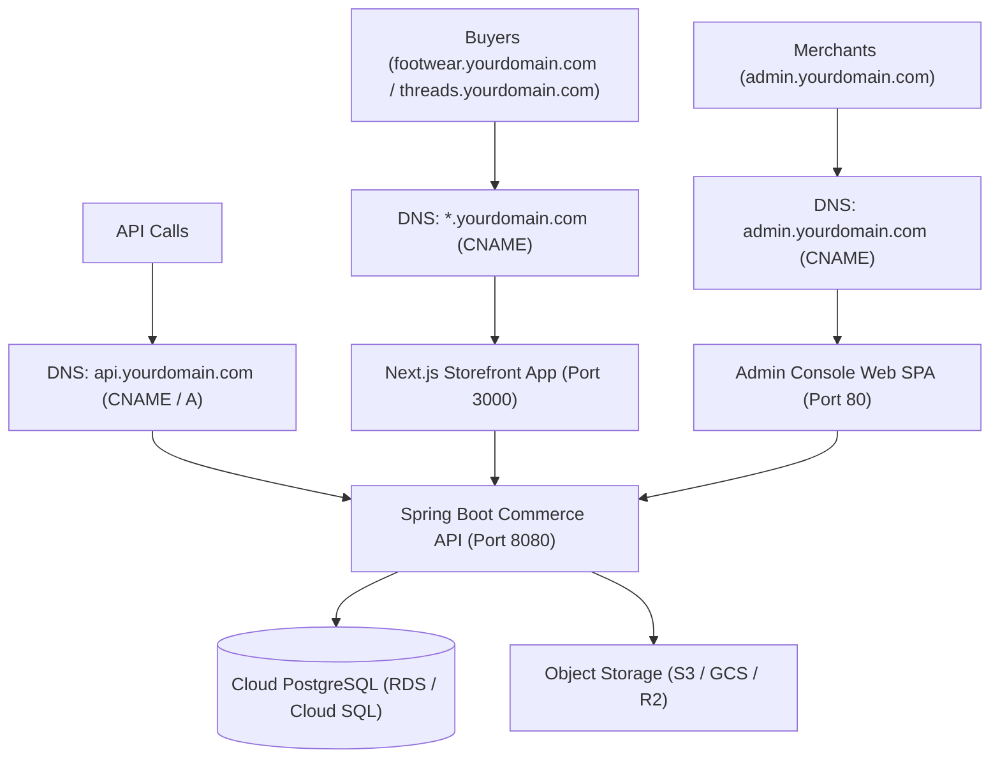

# Cloud Production Deployment Guide 🚀
## Major Cloud Providers (AWS / GCP / Azure) with Custom Wildcard Domains

---

## 🌐 1. Domain & DNS Routing Architecture

Assuming your primary custom domain is **`yourdomain.com`**:



### DNS Records to Create at Your Domain Registrar (or Cloudflare / Route53)

| Type | Host / Name | Target / Destination | Purpose |
| :--- | :--- | :--- | :--- |
| **A / CNAME** | `api` | Backend Cloud URL / Load Balancer IP | Commerce API Service |
| **CNAME** | `admin` | Admin Web App URL / CDN Bucket | Merchant Admin Console |
| **CNAME** | `@` / `www` | Storefront Cloud URL / CDN | Main Storefront Landing |
| **CNAME** | `*` *(Wildcard)* | Storefront Cloud URL / CDN | All Tenant Subdomains (`store1.yourdomain.com`) |

> [!TIP]
> **Use Cloudflare for DNS & SSL**: Managing DNS through Cloudflare provides free, automated Wildcard SSL certificates (`*.yourdomain.com`) and DDoS protection out of the box with zero configuration.

---

## 🗄️ 2. Database Provisioning (Cloud PostgreSQL)

### Provider Options
* **AWS**: Amazon RDS PostgreSQL 16 (db.t4g.micro for dev/staging or db.t4g.small for production).
* **Google Cloud**: Cloud SQL for PostgreSQL 16 (db-f1-micro / db-custom-1-3840).
* **Azure**: Azure Database for PostgreSQL Flexible Server (Burstable B1ms / B2s).
* **Managed Serverless Alternative**: Supabase or Neon PostgreSQL (Instant provisioning with connection pooling).

### Database Configuration Steps:
1. Create a database named `amazingdeal_commerce`.
2. Ensure the firewall / Security Group permits inbound connections on port `5432` from your backend container.
3. Obtain the JDBC connection URL:
   ```text
   jdbc:postgresql://<DB_HOST>:5432/amazingdeal_commerce?sslmode=require
   ```
4. **Flyway Migrations**: You do not need to run manual SQL scripts! When `services/commerce-api` boots up in `prod` profile, Flyway automatically applies all schema migrations (`V1`, `V2`, `V3`) and data seeding on the fresh database.

---

## 🐳 3. Building & Pushing Production Container Images

The codebase now includes optimized, production-ready multi-stage Dockerfiles:

| Service | Dockerfile Location | Base Image | Port |
| :--- | :--- | :--- | :--- |
| **Commerce API** | [services/commerce-api/Dockerfile](file:///c:/Users/drskp/Projects/amazingdeal-platform/services/commerce-api/Dockerfile) | `eclipse-temurin:21-jre-alpine` | `8080` |
| **Storefront Web** | [apps/storefront-web/Dockerfile](file:///c:/Users/drskp/Projects/amazingdeal-platform/apps/storefront-web/Dockerfile) | `node:20-alpine` (Standalone) | `3000` |
| **Admin Web** | [apps/admin-web/Dockerfile](file:///c:/Users/drskp/Projects/amazingdeal-platform/apps/admin-web/Dockerfile) | `nginx:alpine` (Static SPA) | `80` |

### Build Commands (Run from root repository)

```bash
# 1. Backend REST API
docker build -t your-registry/commerce-api:latest -f services/commerce-api/Dockerfile ./services/commerce-api

# 2. Buyer Storefront Web
docker build -t your-registry/storefront-web:latest -f apps/storefront-web/Dockerfile .

# 3. Merchant Admin Web
docker build -t your-registry/admin-web:latest -f apps/admin-web/Dockerfile .
```

Push the images to your container registry (AWS ECR, Google Artifact Registry, or Docker Hub).

---

## 🚀 4. Service Deployment Options on Major Clouds

### Option A: Google Cloud Platform (Recommended for simplicity & cost)
* **Backend**: Deploy `commerce-api` on **Google Cloud Run**
  * CPU: 1 vCPU, Memory: 1-2 GiB, Min instances: 0 or 1.
  * Connect to Cloud SQL via Cloud SQL Auth Proxy.
* **Storefront**: Deploy `storefront-web` on **Google Cloud Run** (Port 3000).
* **Admin**: Deploy `admin-web` on **Google Cloud Storage + Cloud CDN** or Cloud Run.
* **Domain Mapping**: Use Cloud Run Domain Mapping or an HTTPS Load Balancer with a Wildcard SSL certificate.

### Option B: Amazon Web Services (AWS)
* **Backend**: Deploy on **AWS ECS Fargate** or **AWS App Runner**.
* **Storefront**: Deploy on **AWS ECS Fargate** or **AWS Amplify Hosting**.
* **Admin**: Deploy static assets directly to an **S3 Bucket + CloudFront CDN**.
* **SSL & DNS**: AWS Certificate Manager (ACM) for `*.yourdomain.com` + Route 53.

---

## ⚙️ 5. Required Production Environment Variables

Use the provided template at [.env.production.example](file:///c:/Users/drskp/Projects/amazingdeal-platform/.env.production.example):

### Backend (`commerce-api`):
```env
SPRING_PROFILES_ACTIVE=prod
SPRING_DATASOURCE_URL=jdbc:postgresql://<DB_HOST>:5432/amazingdeal_commerce?sslmode=require
SPRING_DATASOURCE_USERNAME=postgres
SPRING_DATASOURCE_PASSWORD=<DB_PASSWORD>
APP_JWT_SECRET=<YOUR_64_CHAR_HEX_SECRET>
APP_MEDIA_UPLOAD_DIR=/app/uploads
APP_MEDIA_BASE_URL=https://api.yourdomain.com/media
APP_CORS_ALLOWED_ORIGINS=https://yourdomain.com,https://*.yourdomain.com,https://admin.yourdomain.com
```

### Storefront (`storefront-web`):
```env
NODE_ENV=production
NEXT_PUBLIC_API_URL=https://api.yourdomain.com/api/v1
```

### Admin Console (`admin-web`):
```env
VITE_API_BASE_URL=https://api.yourdomain.com/api/v1
```

---

## 🔒 6. Post-Deployment Verification Checklist

1. [ ] **Backend Health**: `GET https://api.yourdomain.com/actuator/health` returns `{"status":"UP"}`.
2. [ ] **Swagger UI**: `https://api.yourdomain.com` redirects to `/swagger-ui/index.html`.
3. [ ] **Admin Console**: `https://admin.yourdomain.com` loads and authenticates successfully (`admin@stridefootwear.com` / `password123`).
4. [ ] **Storefront Multi-Tenancy**:
   - `https://footwear.yourdomain.com` renders Stride Footwear.
   - `https://threads.yourdomain.com` renders Urban Threads.
   - Adding items to cart and checkout flow executes smoothly.
