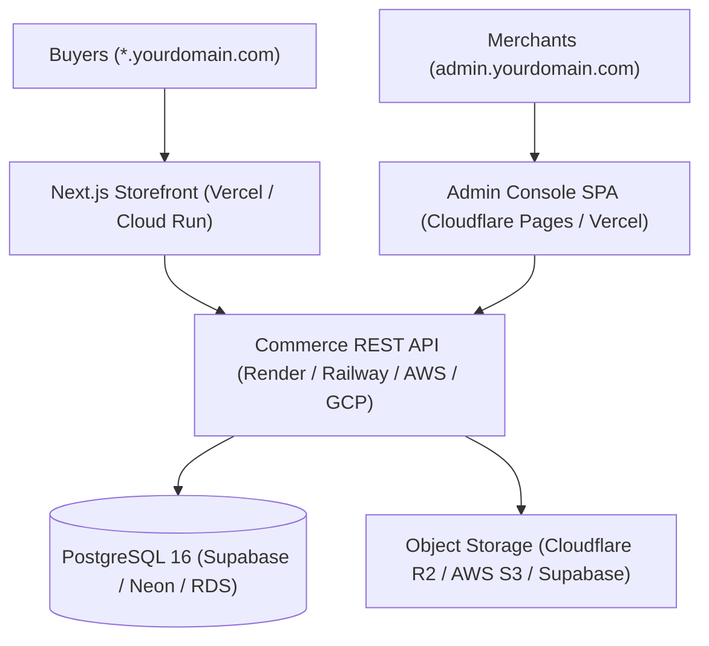
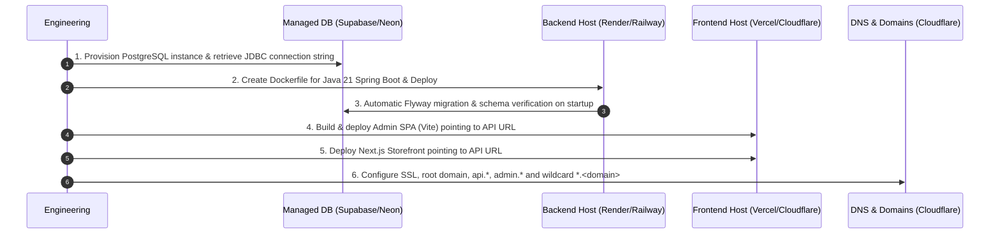

# AmazingDeal Cloud Deployment & Infrastructure Plan 🚀

This document details the migration path from local development to production cloud hosting for the **AmazingDeal Multi-Tenant Platform**.

---

## 🏗️ Architecture Overview

The platform consists of four distinct architectural tiers:

---

## 📋 Component Breakdown & Cloud Requirements

| Component | Technology | Nature | Recommended Cloud Options | Env Variables Needed |
| :--- | :--- | :--- | :--- | :--- |
| **Database** | PostgreSQL 16 | Relational DB | **Supabase** (Free 500MB) or **Neon** (Free 0.5GB Serverless) or **AWS RDS** | `SPRING_DATASOURCE_URL`, `SPRING_DATASOURCE_USERNAME`, `SPRING_DATASOURCE_PASSWORD` |
| **Backend API** | Spring Boot 3.3.4 (Java 21) | Containerized REST Service | **Render** Web Service, **Railway**, **Google Cloud Run**, or **DigitalOcean App Platform** | `SPRING_PROFILES_ACTIVE=prod`, `APP_JWT_SECRET`, `APP_CORS_ALLOWED_ORIGINS` |
| **Storefront** | Next.js 14 App Router | SSR + Edge Middleware | **Vercel** (Best for Wildcard Edge Rewriting) or **Docker on Cloud Run** | `NEXT_PUBLIC_API_URL` |
| **Admin Console** | Vite + React 18 | Static SPA | **Cloudflare Pages** ($0) or **Vercel** ($0) | `VITE_API_BASE_URL` |
| **Media / File Uploads** | Spring Multipart | Object Storage | **Cloudflare R2** ($0 egress) or **Supabase Storage** or **AWS S3** | `APP_MEDIA_STORAGE_TYPE`, `AWS_S3_BUCKET`, etc. |

---

## 🎯 Proposed Cloud Strategies

### Strategy A: The Zero-Cash / Indie Hacker Stack ($0 - $5/mo)
* **Best for**: Immediate testing, MVP launch, demonstrations, pitch decks.
* **Database**: **Supabase** or **Neon** (Free managed PostgreSQL tier).
* **Backend**: **Render** or **Railway** (Dockerized Spring Boot container).
* **Storefront**: **Vercel** Hobby ($0/mo, native Next.js 14 support with wildcard custom domain support).
* **Admin Web**: **Cloudflare Pages** ($0/mo, ultra-fast global edge CDN).
* **Media Storage**: **Supabase Storage** or **Cloudflare R2** (10 GB free, $0 egress fees).

### Strategy B: Single-Provider VPS / PaaS ($10 - $25/mo)
* **Best for**: Production stability with no free-tier cold starts or spin-downs.
* **Database & Backend**: **DigitalOcean** / **Hetzner** / **Linode** VPS running Docker Compose or managed App Platform.
* **Storefront & Admin**: **Vercel** or **Cloudflare Pages**.
* **Storage**: **AWS S3** or **Backblaze B2** + Cloudflare CDN.

### Strategy C: Enterprise AWS / GCP Cloud-Native
* **Best for**: High scale, enterprise SLAs.
* **Database**: AWS Aurora PostgreSQL / GCP Cloud SQL.
* **Backend**: AWS ECS Fargate or GCP Cloud Run.
* **Storefront**: AWS Amplify / Vercel Enterprise.
* **Media**: AWS S3 + CloudFront.

---

## 🛠️ Step-by-Step Implementation Roadmap

### Phase 1: Database Migration
1. Provision PostgreSQL on Supabase or Neon.
2. Verify Flyway migrations execute cleanly during initial connection.
3. Seed baseline production tenants or default stores.

### Phase 2: Containerizing the Backend
1. Create a multi-stage `Dockerfile` in `services/commerce-api` using `eclipse-temurin:21-jre-alpine` for minimal image size (~180MB).
2. Configure environment variable injection for secrets (`APP_JWT_SECRET`) and database credentials.
3. Update CORS configuration in `application.yml` to support production domains.

### Phase 3: Media Storage Decoupling
1. The local disk `./uploads` should be enhanced with an S3-compatible cloud storage adapter (e.g. AWS S3, Cloudflare R2, or Supabase Storage) so images persist across container redeployments.

### Phase 4: Frontend Deployment & Wildcard Multi-Tenancy
1. **Admin Console**: Deploy `apps/admin-web` on Cloudflare Pages / Vercel with environment variable `VITE_API_BASE_URL=https://api.yourdomain.com/api/v1`.
2. **Storefront**: Deploy `apps/storefront-web` on Vercel.
3. Configure Wildcard Domain `*.yourdomain.com` in Vercel so tenants like `footwear.yourdomain.com` dynamically resolve via Next.js middleware.
