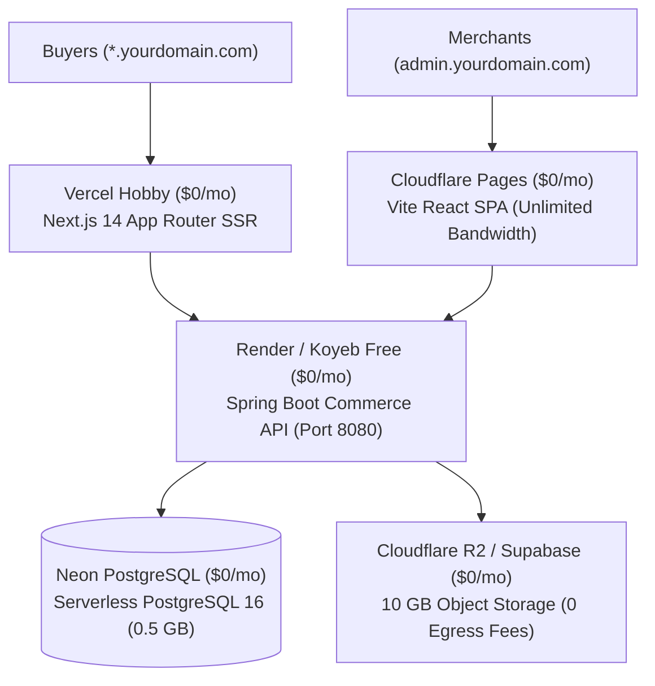

# 100% Free Cloud Deployment Guide 🚀
## Strategy A: The $0/Month Stack for AmazingDeal Multi-Tenant Platform

This guide provides an end-to-end walkthrough to deploy the entire **AmazingDeal Multi-Tenant Commerce Platform** with **$0.00 infrastructure cost**, **zero credit card required** for initial signup, and **100% free forever tiers**.

---

## 🏗️ 1. The $0/Month Architecture



### Free Tier Component Breakdown

| Tier | Provider | Cost | Specs & Free Allowance |
| :--- | :--- | :--- | :--- |
| **Database** | **Neon PostgreSQL** | **$0.00** | Serverless PostgreSQL 16, 0.5 GB storage, autoscaling compute, pooled connections |
| **Backend API** | **Render** or **Koyeb** | **$0.00** | Docker container, 512 MB RAM, free HTTPS URL, auto-deploy from Git |
| **Storefront Web** | **Vercel** | **$0.00** | Native Next.js 14 SSR, global edge network, wildcard domain support |
| **Admin Web** | **Cloudflare Pages** | **$0.00** | Unlimited bandwidth, global CDN (300+ cities), instant builds |
| **Media Storage** | **Cloudflare R2** | **$0.00** | 10 GB storage, $0 egress fees (unlimited bandwidth) |
| **DNS & SSL** | **Cloudflare DNS** | **$0.00** | Free automated Wildcard SSL (`*.yourdomain.com`), DDoS protection |

---

## 🗄️ Step 1: Provision Free Database on Neon (2 Minutes)

Neon offers serverless PostgreSQL with zero credit card required.

1. Go to [neon.tech](https://neon.tech) and sign up with your GitHub account.
2. Click **Create Project**:
   * **Project Name**: `amazingdeal-commerce`
   * **Database Name**: `amazingdeal_commerce`
   * **Region**: Choose closest to you (e.g. `US East (N. Virginia)` or `EU (Frankfurt)`).
3. Under **Connection Details**, select **Pooled connection** and **Java / JDBC**:
   You will get a connection string formatted like this:
   ```text
   jdbc:postgresql://ep-summer-water-123456-pooler.us-east-1.aws.neon.tech/amazingdeal_commerce?sslmode=require
   ```
4. Copy the:
   * **JDBC URL**
   * **User**: (e.g. `neondb_owner`)
   * **Password**: (e.g. `npg_xxxxxxxxxxxx`)

> [!NOTE]
> Flyway will run automatically! As soon as `commerce-api` connects to Neon on startup, all tables (`V1`, `V2`, `V3`) and sample tenants (`footwear`, `threads`) will be created automatically.

---

## 🐳 Step 2: Deploy Backend API on Render (Free Web Service)

Render provides free Docker hosting with automatic HTTPS certificates.

### 2.1 Push Code to GitHub
Ensure your repository is pushed to a GitHub account (public or private).

### 2.2 Create Free Web Service on Render
1. Go to [dashboard.render.com](https://dashboard.render.com) and click **New + > Web Service**.
2. Connect your GitHub repository.
3. Configure settings:
   * **Name**: `amazingdeal-api`
   * **Region**: Match your Neon region (e.g., `Ohio (US East)`).
   * **Root Directory**: `services/commerce-api`
   * **Runtime**: `Docker`
   * **Docker Command**: Leave default (uses `services/commerce-api/Dockerfile`).
   * **Instance Type**: **Free** (512 MB RAM, 0.1 CPU).
4. Add the following **Environment Variables**:

| Variable | Value |
| :--- | :--- |
| `SPRING_PROFILES_ACTIVE` | `prod` |
| `SPRING_DATASOURCE_URL` | `<YOUR_NEON_JDBC_URL>` |
| `SPRING_DATASOURCE_USERNAME` | `<YOUR_NEON_USER>` |
| `SPRING_DATASOURCE_PASSWORD` | `<YOUR_NEON_PASSWORD>` |
| `APP_JWT_SECRET` | `404E635266556A586E3272357538782F413F4428472B4B6250645367566B5970` |
| `APP_CORS_ALLOWED_ORIGINS` | `*` (or your frontend domains) |
| `JAVA_OPTS` | `-XX:+UseContainerSupport -XX:+UseSerialGC -Xss512k -XX:MaxRAMPercentage=75.0` |

> [!TIP]
> `-XX:+UseSerialGC` reduces memory footprint so Spring Boot 3 runs lean and fast inside Render's 512 MB free tier.

5. Click **Create Web Service**.
6. When deployment finishes, you will receive your free public HTTPS URL:
   `https://amazingdeal-api.onrender.com`

### 2.3 Verify Health
Visit in your browser:
```text
https://amazingdeal-api.onrender.com/actuator/health
```
Expected output: `{"status":"UP"}`.

---

## ⚡ Step 3: Deploy Storefront Web on Vercel (Free Next.js 14 SSR)

Vercel is the creator of Next.js and provides the best free hosting tier for Next.js 14 App Router.

1. Go to [vercel.com](https://vercel.com) and log in with GitHub.
2. Click **Add New... > Project** and import your repository.
3. Configure the Project:
   * **Framework Preset**: `Next.js`
   * **Root Directory**: Click edit and select `apps/storefront-web`.
4. Under **Environment Variables**, add:
   * `NEXT_PUBLIC_API_URL` = `https://amazingdeal-api.onrender.com/api/v1`
5. Click **Deploy**.
6. Once deployed, you will receive a free domain:
   `https://amazingdeal-storefront.vercel.app`

### 3.1 Wildcard Custom Domain Setup on Vercel
1. Under project **Settings > Domains**, add:
   * `yourdomain.com`
   * `*.yourdomain.com` (Wildcard domain for multi-tenant stores)
2. Follow Vercel's instructions to add the CNAME record in your DNS registrar (or Cloudflare).
3. Now, visiting `footwear.yourdomain.com` or `threads.yourdomain.com` resolves automatically via Next.js middleware!

---

## 🖥️ Step 4: Deploy Merchant Admin Web on Cloudflare Pages ($0/mo)

Cloudflare Pages offers unlimited free bandwidth and ultra-fast global distribution for static React/Vite SPAs.

1. Go to [dash.cloudflare.com](https://dash.cloudflare.com) and navigate to **Compute (Workers) > Pages**.
2. Click **Connect to Git** and select your repository.
3. Build Settings:
   * **Framework preset**: `Vite`
   * **Root directory**: `apps/admin-web`
   * **Build command**: `pnpm run build`
   * **Build output directory**: `dist`
4. Environment Variables:
   * `VITE_API_BASE_URL` = `https://amazingdeal-api.onrender.com/api/v1`
5. Single Page Application (SPA) Routing Rule:
   In `apps/admin-web/public`, ensure a `_redirects` file exists with:
   ```text
   /*  /index.html  200
   ```
   *(This ensures refreshing `/tenants` or `/products` routes to `/index.html` without 404 errors)*.
6. Click **Save and Deploy**.
7. You receive a free URL: `https://amazingdeal-admin.pages.dev`.

---

## 🌐 Step 5: Custom Domain & Wildcard DNS Mapping (Cloudflare)

If you have a domain (e.g. `yourdomain.com`), configure Cloudflare DNS (100% Free):

| Type | Name | Content / Target | Proxy Status | Purpose |
| :--- | :--- | :--- | :--- | :--- |
| **CNAME** | `api` | `amazingdeal-api.onrender.com` | DNS Only (Gray Cloud) | Backend REST API |
| **CNAME** | `admin` | `amazingdeal-admin.pages.dev` | Proxied (Orange Cloud) | Merchant Admin Console |
| **CNAME** | `@` | `cname.vercel-dns.com` | DNS Only (Gray Cloud) | Root Marketplace Landing |
| **CNAME** | `*` | `cname.vercel-dns.com` | DNS Only (Gray Cloud) | Wildcard Tenant Subdomains |

---

## 🧪 Step 6: Verification Checklist

1. [ ] **Database Connection**: Neon project console shows active tables (`tenants`, `users`, `products`, `orders`).
2. [ ] **Backend Health**: `GET https://amazingdeal-api.onrender.com/actuator/health` returns `{"status":"UP"}`.
3. [ ] **Swagger Documentation**: `https://amazingdeal-api.onrender.com/swagger-ui/index.html` renders all REST endpoints.
4. [ ] **Merchant Admin Console**: Login to `https://amazingdeal-admin.pages.dev` with `admin@stridefootwear.com` / `password123`.
5. [ ] **Buyer Storefront**: Visit `https://amazingdeal-storefront.vercel.app` (or `footwear.yourdomain.com`) and test adding to cart and checkout.

---

## 💰 Cost Comparison: Strategy C vs. Strategy A

| Item | Strategy C (AWS Enterprise) | Strategy A (Free Cloud) |
| :--- | :--- | :--- |
| **PostgreSQL Database** | ~$44 / month (Aurora) | **$0.00** (Neon Serverless) |
| **Container Backend** | ~$70 / month (ECS Fargate) | **$0.00** (Render / Koyeb) |
| **Load Balancer & NAT** | ~$55 / month (ALB + NAT) | **$0.00** (Included) |
| **Storefront Web** | ~$10 / month (Amplify) | **$0.00** (Vercel Hobby) |
| **Admin Console** | ~$3 / month (CloudFront + S3) | **$0.00** (Cloudflare Pages) |
| **Monthly Total** | **~$182 - $230+ / month** | **$0.00 / month** |
